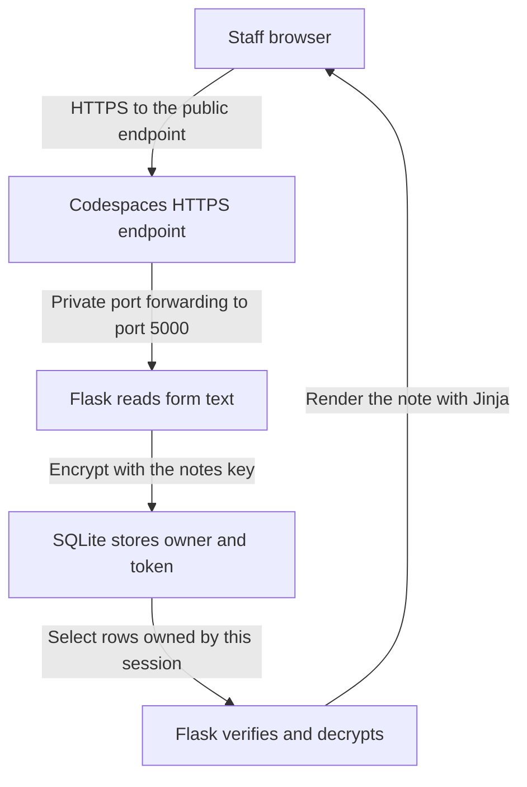

# Where does a note need protection?

**Independent introduction · 10 minutes.** Imagine Alex types “Café meeting in room B” into a college notes form. The college must protect the journey, the stored copy and the decision about who can see it.

**Read the diagram.** Alex and Flask both need readable text. HTTPS protects the browser connection to the public endpoint. Flask encrypts the body again before writing it to SQLite. Staff identities and note IDs stay visible in the database. Anyone who controls the running application may also be able to read its plaintext and key.

| Requirement | Technique and reasoning |
|---|---|
| Check a login password | A password hashing function such as Argon2id uses a unique salt and a deliberate cost. Verify a later guess against the stored hash. |
| Read a confidential note later | Authenticated symmetric encryption uses a secret key to encrypt and to verify/decrypt. A changed token fails verification. |
| Verify a published document | The publisher signs with a private signing key. A reader with the publisher’s authentic public key can verify the signature and the document. The contents may be public. |
| Exchange private web requests | TLS authenticates the server to the browser and protects traffic in transit. Clients validate the certificate name, dates and trust chain. |
| Verify data shared by two services | A keyed message authentication code (MAC), such as HMAC, lets a holder of the shared secret verify the data. Either service with the secret can create a valid tag. |

A plain cryptographic hash produces a digest. If you already have a trustworthy expected digest, comparison can detect a changed file. If someone can replace both a file and its published digest, that comparison offers little assurance about authorship.

**Check your understanding.** Suppose someone obtains just a copy of the notes database. What can they see? Suppose they also obtain the encryption key. Which protection has been lost? Then open [Activity 1](../worksheets/activity-1.md).

Further reading: [OWASP password storage](https://cheatsheetseries.owasp.org/cheatsheets/Password_Storage_Cheat_Sheet.html), [Fernet](https://cryptography.io/en/stable/fernet/), [digital signatures](https://developer.mozilla.org/en-US/docs/Glossary/Signature/Security) and [TLS](https://developer.mozilla.org/en-US/docs/Glossary/TLS).
