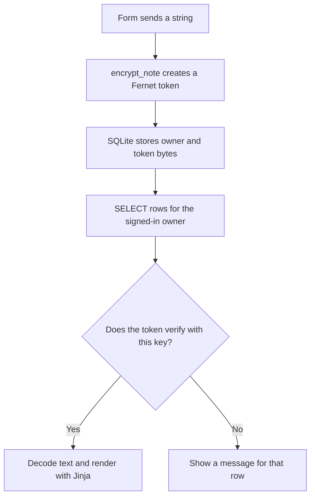

# Exercise 1 · Encrypt and retrieve a confidential note

**45 minutes · Guided individual coding, then independent checks.** Alex needs to read a fictional meeting note after closing the browser. A backup of SQLite should contain an authenticated encrypted token, and Sam should only see Sam’s notes. You will implement both transformations in `note_crypto.py` and see where the supplied route uses them.

**Start here.** Open a terminal in the repository root and run `source .venv/bin/activate`. If the environment is missing, use the [setup instructions](../README.md#open-your-development-environment). The starter supplies sign-in, SQL and HTML. Its shared Exercise 1 key is a **public teaching fixture**. Practise with fictional text.

## A · Trace one save and one read · 5 minutes

In `app.py`, find `def notes()`. The same route handles a POST when you save and a GET when you open the page. In `storage.py`, look at `owned_notes`. Read the `?` placeholder as “insert the value supplied separately”. The owner comes from the signed-in session.



The token is a package of encrypted data and verification information. The library encodes the package using URL-safe Base64. Base64 makes bytes convenient to represent. Anyone can reverse that encoding. The secret Fernet key supplies the protection.

## B · Worked example and save function · 10 minutes

Run this whole block in the terminal. It uses a temporary key in memory so you can concentrate on types.

```bash
python - <<'PY'
from cryptography.fernet import Fernet

cipher = Fernet(Fernet.generate_key())
text = "Café meeting in room B"
plain_bytes = text.encode("utf-8")
token = cipher.encrypt(plain_bytes)
print(type(text).__name__, type(plain_bytes).__name__, type(token).__name__)
print("Token preview:", token[:12])
print("Recovered text:", cipher.decrypt(token).decode("utf-8"))
PY
```

Expect `str bytes bytes`, a short token preview and the original text. `generate_key()` creates key material. `Fernet(...)` builds an object that can encrypt and verify/decrypt. `encode("utf-8")` turns the characters, including é, into bytes. `encrypt` returns token bytes for the BLOB column. The preview can vary between runs.

Open `note_crypto.py`. Replace the `raise NotImplementedError(...)` line inside **encrypt_note** with these two indented lines. Preserve its existing function signature. Save the file.

```python
    plaintext = text.encode("utf-8")
    return cipher.encrypt(plaintext)
```

`return` hands the result back to `app.py`. Read the next two lines of the POST branch there: the route passes the returned token and the owner to `storage.add_note`. The key was supplied by the caller. Generating a new key inside this function would leave the normal read path with a different key.

## C · Complete the read function · 10 minutes

In `decrypt_note`, replace the remaining `raise`. You receive a token as bytes and the same `cipher` object. First verify and decrypt the token. Then convert the recovered bytes to a Python string for the template. Use two named steps so you can explain the type of each result. Allow `InvalidToken` to reach the route.

<details><summary>Hint if you get stuck</summary>

The terminal example used `cipher.decrypt(token)` and `.decode("utf-8")`. Assign the result of the first operation to a local variable, then return the result of the second. The [completed functions](../solutions/exercise-1/note_crypto.py) provide a final comparison.
</details>

```bash
python -m unittest -v checks.test_notes
```

The command asks Python’s built-in test runner to call four small checks. Each `ok` means the observed behaviour matched an expectation. `ERROR` means an exception interrupted a check. `FAIL` means a result differed. Start with the last line of the first failing check. Expect **4 tests, OK** when both functions work.

## D · Compare the browser with SQLite · 10 minutes

1. Run `python app.py` in terminal A. Leave it running. The terminal prints temporary codes for **alex** and **sam**. Open the private **5000** entry in the Codespaces **Ports** panel. A local-machine alternative is `http://127.0.0.1:5000/`.
2. Sign in as **alex** using Alex’s code. Save **Café meeting in room B**. Check that the accent survives. The form POST redirects to a GET that reads, verifies, decrypts and renders the saved row.
3. Open terminal B in the same Codespace. In the repository root run:

```bash
source .venv/bin/activate
python -m tools.inspect_notes
```

A typical fresh row looks like `id=1 owner=alex storage=blob bytes=120 prefix=gAAAAA...`. The ID, length and preview depend on your data. `blob` means SQLite stored bytes. The type or appearance alone cannot establish encryption. Point to the actual `cipher.encrypt` call and the round-trip check as additional evidence.

Save a second fictional note. In [your evidence sheet](../worksheets/evidence.md#exercise-1), record one browser observation, one database observation and a field still in plaintext.

## E · Investigate a changed record and a second staff account · 10 minutes

**Predict first.** What should happen to an intact note, a damaged token and Alex’s notes when Sam signs in?

1. In terminal B, open `tools/tamper_sample.py` and find `raw[25] ^= 1`. The helper creates one disposable encrypted note, changes a single ciphertext bit in a copy and keeps the original tag. Run it yourself:

   ```bash
   python -m tools.tamper_sample
   ```

   Expect `Original: Disposable practice note`, `Changed copy: rejected (InvalidToken).` and the ID of a new sample row owned by Alex. Each run adds a new sample.
2. Refresh Alex’s page. The new row says **This note could not be verified.** Check that one intact note is still readable. Explain why showing the corrupt bytes or partial plaintext would be misleading.
3. Sign out and sign in as **sam**. Compare the list. Sign back in as Alex to confirm the notes still exist. Find the SQL condition that accounts for the difference.
4. Complete your Exercise 1 evidence. Why could a different valid key cause the same error as a changed token? What distinguishes the two situations in *this* experiment?

**Finish.** Stop the server in terminal A with **Ctrl+C** before Exercise 2. Keep `instance/notes-1.sqlite3` for comparison.

| If you see… | Try this |
|---|---|
| `NotImplementedError` or the browser’s “finish the two functions” message | Save both functions and restart `python app.py`. Use the new sign-in code. |
| `TypeError` about bytes | Check the input to `encrypt`. Plain text needs UTF-8 encoding once. SQLite already returns token bytes. |
| Old behaviour after an edit | Stop and restart the server. Automatic reloading is disabled so learners can see which code is running. |
| No notes in the inspection tool | Check the active account, repository and database path. The default for this exercise is `instance/notes-1.sqlite3`. |

Reference: [Fernet encryption, key format and InvalidToken](https://cryptography.io/en/stable/fernet/).
