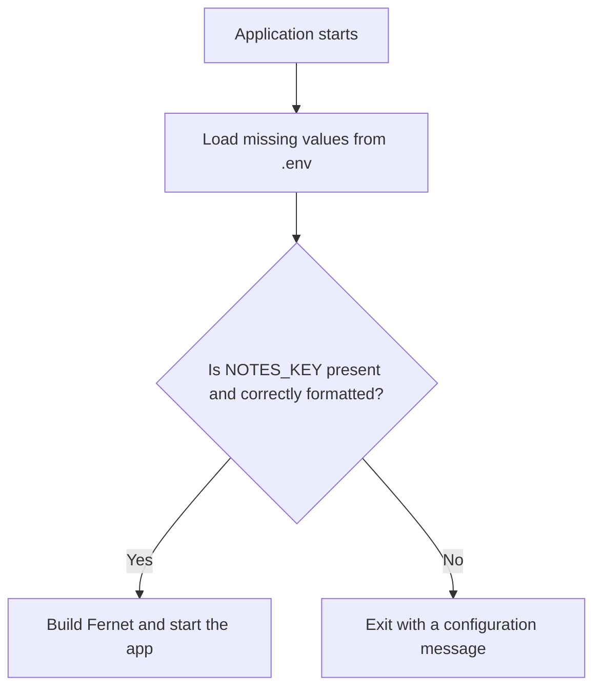

# Exercise 2 · Move the notes key out of source

**25 minutes · Guided configuration change, then independent failure tests.** The starter gives every copy of the repository the same public practice key. Anyone who acquires that key and a copy of the database could read the note bodies or produce valid tokens. Give this installation its own key and make startup fail clearly when that key is unusable.

**Joining here?** Activate `.venv` using the [setup guide](../README.md#open-your-development-environment). If `note_crypto.py` is still the untouched starter, copy the completed functions with `cp solutions/exercise-1/note_crypto.py note_crypto.py`. If you already wrote them, keep your work. Stop any Flask server with **Ctrl+C**.

## A · Create one local key · 5 minutes

```bash
python -m tools.make_env
git check-ignore -v .env
```

The first command writes a randomly generated key into `.env` once. Running it again keeps the existing file. Expect `Created .env with a new local NOTES_KEY.` or `Keeping the existing .env...`. The second command prints the matched `.gitignore` rule and filename without displaying the value.

| Item | Purpose |
|---|---|
| `.env.example` | A shareable template naming the variable. Its value is empty. |
| `.env` | A local text file containing this installation’s key. A user or process that can read the file can read the secret. |
| `.gitignore` | Stops Git offering untracked matching files for addition. It cannot remove a secret that was already committed. |
| `os.environ` | Python’s mapping of environment variable names to values in the current process. |
| `python-dotenv` | Reads the local file and fills missing process variables. An already-set process variable takes priority with `override=False`. |

## B · Connect configuration to startup · 8 minutes

Open `settings.py`. The supplied `validate_key` handles two cases: no value and a value Fernet cannot use. `ConfigurationError` carries a short, secret-free message. The app calls `build_cipher` before opening its listening port.

Inside `build_cipher` **replace its entire body**, including the starter key and its return line. Begin with this worked line:

```python
    load_dotenv(env_file, override=False)
```

`env_file` defaults to the repository’s `.env`. A deployment can supply a real environment variable. Preserve its priority. Now complete the function yourself: read the value named `NOTES_KEY` from `os.environ`, pass it to `validate_key` and return the resulting Fernet object. The helper needs to receive `None` when the variable is absent.

<details><summary>Hint and small example</summary>

`os.environ.get("ROOM_NAME")` returns the value of ROOM_NAME or `None`. Apply that pattern to the notes variable. Calling `validate_key(value)` turns a valid value into a Fernet object and raises a clear error for a bad value. Return its result. The imports are already present.
</details>



Run `python app.py --check-config`. Expect `Configuration OK.` A format check only establishes that Fernet accepts the key. An existing token is needed to establish that the key can open a particular record.

## C · Predict and test three startup cases · 8 minutes

Fill in predictions in [your evidence sheet](../worksheets/evidence.md#exercise-2) before running these commands individually. Run each `echo $?` immediately after its corresponding command. The value is the exit code of the previous process. Zero means success.

```bash
python app.py --check-config
echo $?
env -u NOTES_KEY python app.py --check-config --env-file /dev/null
echo $?
NOTES_KEY=short python app.py --check-config
echo $?
```

For the missing case, `env -u` removes the variable **for that command** and `/dev/null` supplies an empty file. For the invalid case, the temporary shell assignment takes priority over the valid local file. Both tests preserve your real key. Expect codes **0, 2, 2**. Record the distinct messages, then explain why the invalid value won.

```bash
python -m unittest -v checks.test_config
```

Expect **4 tests, OK**. If every case succeeds, inspect `build_cipher` for a leftover return of the training key. If the missing case succeeds, check both the `-u` and `--env-file` arguments.

## D · Prove the same key works after a restart · 4 minutes

1. Run `python app.py --db instance/notes-2.sqlite3`. This new database is for the new key. Open port 5000, sign in as Alex and save a short fictional note, for example **Room C**.
2. Stop with **Ctrl+C**, run the **same** command, sign in with the new temporary access code and read your note. The access code changes each run. The local Fernet key persists.
3. Record the result and explain why automatically generating a key during every startup would put earlier notes at risk. Check `git status --short`. The edited `settings.py` can be committed.

**Why start a fresh file?** Exercise 1 rows were written with a different key. Keeping both practice databases preserves that evidence. In a real migration, existing records would need access to their earlier key until they were safely re-encrypted. Replacing a configuration value alone does not migrate records.

**At minute 95:** stop the server and complete the [five-minute individual check](../worksheets/evidence.md#five-minute-individual-check). Use [the worked explanation](../solutions/exercise-2/README.md) afterwards.

References: [python-dotenv](https://pypi.org/project/python-dotenv/) and [Fernet key management](https://cryptography.io/en/stable/fernet/).
