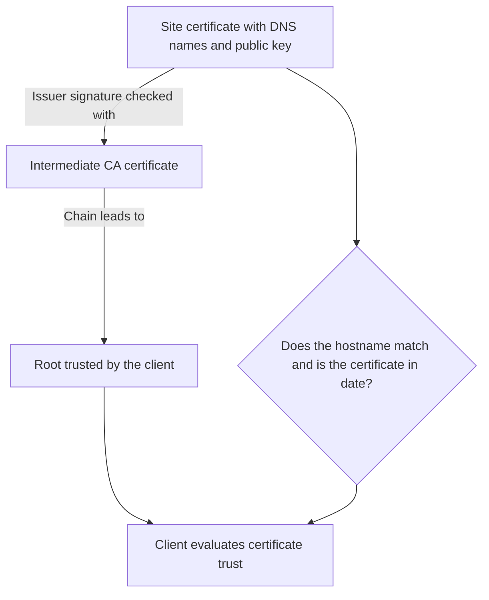

# Exercise 3 · TLS certificates and HTTPS

**20 minutes · Fully guided, standalone walkthrough.** You need a browser and two terminal tabs in the same Codespace, with Python, OpenSSL 3 and curl. You can start here without running Flask or completing the earlier exercises. Run each command from the folder containing `tls/`. Record observations in [the TLS evidence section](../worksheets/evidence.md#exercise-3).

The notes database and the browser connection have different protection needs. Flask uses Fernet to protect a note body on disk. HTTPS uses TLS to authenticate the server and protect the traffic exchanged with it. Both endpoints of a successful connection can see the HTTP data.

## A · Inspect a live public certificate · 5 minutes

1. In your normal browser, open [Let’s Encrypt’s valid ISRG Root X1 test site](https://valid.x1.test-certs.letsencrypt.org/). The current **valid** link is also on the [official certificate list](https://letsencrypt.org/certificates/). An alternative HTTPS site works for this inspection. Note which one you used.
2. In Chrome, open **Developer tools → Privacy and security (or Security) → Security overview → View certificate**. In Firefox, use the site information control beside the address, open **Connection secure → More information → View Certificate**. Control labels can vary between versions. [Chrome guide](https://developer.chrome.com/docs/devtools/security) · [Firefox guide](https://support.mozilla.org/en-US/kb/secure-website-certificate)
3. Select the website’s **leaf certificate**. Record a DNS name from **Subject Alternative Name (SAN)** that covers the host you visited, the issuer and both validity dates. In the certificate hierarchy, identify an issuing CA and the root your browser trusts. A wildcard entry can cover a single matching DNS label.
4. Explain why this client accepted this hostname today. Certificates are renewed, so your dates and intermediate may differ from another student’s. If a managed college browser shows an institutional issuer, record the chain it actually displays and use the official list in Part C for the public-chain comparison.

**What the fields mean.** A certificate binds a public key to a name through the issuer’s signature. A certificate authority (CA) issues and signs certificates. The private key stays with its controller. In a typical modern TLS handshake, the server proves possession of its private key. The client checks the hostname, validity period and a permitted chain of signatures to a locally trusted root. The peers establish traffic keys for authenticated encryption of application data.



A server normally presents its leaf certificate and the necessary intermediates. The client makes its own trust decision using local trust anchors. Seeing the root listed in a certificate viewer does not imply the server sent it.

## B · Generate and test a local certificate · 10 minutes

### Terminal A · Create and inspect the certificate

```bash
bash tls/generate.sh
openssl x509 -in .dev-tls/localhost.crt -noout \
  -subject -issuer -dates -ext subjectAltName -fingerprint -sha256
git check-ignore -v .dev-tls/localhost.key
```

The [commented generator](../tls/generate.sh) uses `openssl req -x509` to issue a self-signed certificate, `-newkey rsa:2048` to generate a key pair and `-days 7` to set the practice lifetime. `-addext` puts `DNS:localhost` in the SAN so the client can check that hostname. `-noenc` leaves the local key without a passphrase. Owner-only file permissions and an ignored directory protect this short-lived lab key. The script preserves an existing pair.

The public certificate is `.dev-tls/localhost.crt`. The private key is `.dev-tls/localhost.key`. Inspect and record **only the certificate**. `-noout` suppresses the PEM body and `-fingerprint -sha256` provides a compact identifier. Expect, with formatting varying by OpenSSL version:

```text
subject=CN=localhost
issuer=CN=localhost
notBefore=<generation time in GMT>
notAfter=<about seven days later in GMT>
X509v3 Subject Alternative Name:
    DNS:localhost
sha256 Fingerprint=<your certificate's hex pairs>
```

Start the [local HTTPS server](../tls/serve.py) and leave it running:

```bash
python tls/serve.py
```

Expect `TLS lab listening on loopback, port 4443.` The script loads the certificate and matching private key into a server-side TLS context. It binds to `127.0.0.1` and replies with one fixed line. Your files stay outside its HTTP response.

### Terminal B · Make two requests to the same server

Open another terminal **inside the same Codespace**. `--ipv4` reaches the server’s IPv4 loopback address. `--noproxy '*'` sends the request directly there. Quote the asterisk so the shell passes it unchanged. `--silent --show-error` hides the progress meter while keeping error messages.

```bash
curl --ipv4 --noproxy '*' --silent --show-error https://localhost:4443/
echo $?
```

A fresh Codespace should report **curl: (60)** with text such as **self-signed certificate**, followed by exit code **60**. The certificate has the correct name, but this client has no trusted path to it in its default trust store. Validation stops the request before HTTP data is accepted.

```bash
curl --ipv4 --noproxy '*' --silent --show-error \
  --cacert .dev-tls/localhost.crt https://localhost:4443/
echo $?
```

Expect `College TLS lab: HTTPS is working.` and exit code **0**. You supplied this specific public certificate as a trust anchor for this invocation. The name and date checks still apply. Record both observations; the server, certificate and URL were the same. Stop terminal A’s server with **Ctrl+C** after both requests.

**Which TLS connection did you inspect?** The public `https://…app.github.dev` address for a forwarded application uses GitHub’s HTTPS endpoint. Our Flask development server listens using HTTP on port 5000. The request to `localhost:4443` goes directly from curl to your Python TLS server inside the Codespace. You can see this server’s self-signed certificate there. [GitHub Codespaces port forwarding](https://docs.github.com/en/codespaces/developing-in-a-codespace/forwarding-ports-in-your-codespace)

## C · Compare with Let’s Encrypt · 5 minutes

Use the public certificate you inspected in Part A and the local fields from Part B. If you used a different issuer in Part A, follow a **valid** test link from [Let’s Encrypt’s published chains](https://letsencrypt.org/certificates/) or use its published chain details for this comparison.

| Question | Local `localhost` certificate | Public certificate issued by Let’s Encrypt |
|---|---|---|
| Who signs the leaf? | The local key holder signs the certificate. | A Let’s Encrypt issuing CA signs it after domain-control validation. |
| Why does the client trust it? | You explicitly supply a certificate you generated yourself. | An acceptable chain leads to a root already trusted by the client. Hostname, validity and other checks still apply. |
| What establishes control of a public name? | The local exercise makes no public domain-control claim. | An ACME challenge can check a token served over HTTP or a record published in DNS. This establishes control of the domain at validation time. |
| Who keeps the private key and handles expiry? | You guard the local key and generate a fresh short-lived pair for another lab. | The operator or hosting provider protects the private key, automates renewal and ensures the service actually loads the renewed certificate. |

Answer the three [reflection questions](../worksheets/evidence.md#exercise-3). Decide which certificate suits a public college portal and which suits a controlled local test. Include one sentence about an expired certificate or a compromised private key. [Let’s Encrypt issuance](https://letsencrypt.org/how-it-works/) · [Challenge types](https://letsencrypt.org/docs/challenge-types/)

**Evidence to hand in.** Copy just the public certificate into your worksheet folder. The original pair stays in the ignored directory. Run this command from the repository root:

```bash
cp .dev-tls/localhost.crt worksheets/localhost.crt
openssl x509 -in worksheets/localhost.crt -noout -fingerprint -sha256
```

Match the fingerprint to the one you recorded earlier. Submit `worksheets/localhost.crt`, the public fields, the two curl outcomes and your explanations. The [worked evidence](../solutions/exercise-3/README.md) shows the level of detail expected.

## Troubleshooting

| Observation | Interpretation and recovery |
|---|---|
| `curl: (7)` or connection refused | Check terminal A is still running the server on 4443, then repeat the request from terminal B in the same Codespace. |
| `curl: (60)` on the second request | Use exactly `localhost`, check the two validity dates and UTC clock, and confirm curl points to the certificate loaded by this server. A DNS SAN for `localhost` does not cover the IP literal `127.0.0.1`. |
| `curl: (77)` or certificate file missing | Return to the repository root. Check `ls -l .dev-tls/localhost.crt`. The `--cacert` argument needs the public certificate path. |
| A browser shows a GitHub-issued or publicly trusted certificate for the port | You opened a forwarded URL. Run the stated curl command against `localhost` inside the Codespace instead. |
| Port already in use | Find the terminal running the earlier lab server. Stop it with Ctrl+C and restart the new one. |
| Incomplete pair, expired pair or key mismatch | Stop the lab server. From the repository root move the old directory aside with `mv .dev-tls ".dev-tls-backup-$(date +%s)"`, then rerun the generator and restart the server. Both the active and backup directories are ignored. |
| Public viewer unavailable | Try the other browser route or a different HTTPS site. Continue the local experiment, then complete the public fields from a real browser observation when available. |
| The first request already succeeds | Check the URL and whether a local trust override already contains this certificate. Try the experiment in a fresh Codespace and record the trust settings you observed. |

Command references: [OpenSSL req](https://docs.openssl.org/3.5/man1/openssl-req/), [OpenSSL x509](https://docs.openssl.org/3.5/man1/openssl-x509/) and [curl certificate verification](https://curl.se/docs/sslcerts.html).
